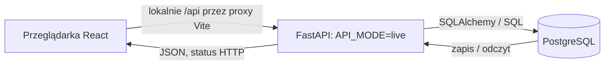

# Z Dech Pies

Projekt e-commerce: katalog, koszyk, zamówienia i panel administratora. W bloku 6 uruchamiamy lokalnie React → FastAPI → PostgreSQL. AWS/CD pozostaje na później.

Zaimplementowano aplikację PWA (React) i backend FastAPI/PostgreSQL. Klient React Native jest planowany. Płatności mają opcjonalną lokalną symulację, bez rzeczywistej bramki.

## Funkcjonalności

**Dla klienta**
- przeglądanie katalogu produktów i kategorii
- zarządzanie koszykiem
- składanie zamówień (rzeczywista bramka płatności jest planowana)
- rejestracja, logowanie i konto użytkownika

**Dla administratora**
- zarządzanie produktami i kategoriami
- podgląd i obsługa zamówień

## Technologie

| Obszar | Technologie |
| --- | --- |
| Frontend (web) | React, TypeScript, PWA |
| Frontend (mobile) | React Native |
| Backend | Python, FastAPI |
| Baza danych | PostgreSQL |
| Chmura | AWS |

## Architektura

System ma architekturę trójwarstwową. W bloku 6 wszystkie warstwy działają lokalnie:

1. **Web:** React/TypeScript i Vite, formularze oraz klient REST.
2. **API:** FastAPI/Uvicorn, logika biznesowa, JWT i walidacja.
3. **Dane:** PostgreSQL 16 i Alembic; `shop_app` dla API, `shop_migrator` dla migracji.

REST/JSON przechodzi przez lokalne proxy Vite `/api`; HTTP jest ograniczony do loopback. Sekrety pochodzą z ignorowanych `.env` i `.env.runtime`. Docelowe AWS opisuje katalog `infra/`.

## Struktura repozytorium

Struktura repozytorium (`web/` odpowiada katalogowi `/frontend` z checklisty):

```
.
├── web/        # aplikacja PWA (React + TypeScript)
├── mobile/     # aplikacja mobilna (React Native)
├── backend/    # API (FastAPI)
├── db/         # migracje, skrypty i dane testowe bazy
├── infra/      # konfiguracja infrastruktury AWS
└── docs/       # dokumentacja projektu
```

## Uruchomienie lokalne

Wymagania: PostgreSQL 16 (Docker Compose lub natywny), Python 3.12+, uv, Node.js 22.12+ i npm 10+. Wariant bez Dockera opisuje [instrukcja lokalna](docs/blok06-local.md).

1. Przygotuj PostgreSQL, role, migracje i uprawnienia według [db/README.md](db/README.md).
   Uzupełnij lokalne `db/.env` i `backend/.env` na podstawie szablonów, używając własnych haseł.
2. W katalogu `backend` wykonaj `uv sync --locked`, skopiuj `.env.runtime.example`
   do `.env.runtime` i ustaw losowy `JWT_SECRET` (co najmniej 32 bajty).
   Pozostaw `API_MODE=live` i `APP_ENV=local`.
3. Wykonaj `uv run python -m app.scripts.seed` (opcjonalny katalog), następnie
   `uv run python -m app.scripts.create_admin admin@example.com` i podaj własne hasło.
4. Uruchom API: `uv run uvicorn app.main:app --reload --host 127.0.0.1 --port 8000`.
5. W drugim terminalu, w `web`, wykonaj `npm ci`, skopiuj `.env.example` do `.env`
   i ustaw `VITE_USE_MOCK_API=false`. Pozostaw `VITE_API_BASE_URL` puste,
   a `API_PROXY_TARGET=http://127.0.0.1:8000`. Wykonaj `npm run dev`.
6. Otwórz adres wypisany przez Vite, zaloguj administratora i przejdź do `/admin`.

W PowerShell kopiowanie plików wykonasz przez `Copy-Item źródło cel`.
Sekrety pozostają poza repozytorium. Szczegóły konfiguracji:
[backend-runtime.md](docs/backend-runtime.md).

## API Endpoints

Prefiks: `/api/v1`. Odczyt katalogu jest publiczny, modyfikacje katalogu wymagają JWT administratora.

| Metoda | Endpoint | Działanie | Sukces |
| --- | --- | --- | --- |
| GET | `/products`, `/products/{id}` | Lista i szczegóły produktu | 200 |
| POST | `/products` | Utworzenie produktu | 201 |
| PATCH | `/products/{id}` | Aktualizacja produktu | 200 |
| DELETE | `/products/{id}` | Ukrycie produktu (`hard=true`: usunięcie bez powiązań) | 204 |
| GET | `/categories`, `/categories/{id}` | Lista i szczegóły kategorii | 200 |
| POST | `/categories` | Utworzenie kategorii | 201 |
| PATCH | `/categories/{id}` | Aktualizacja kategorii | 200 |
| DELETE | `/categories/{id}` | Usunięcie pustej kategorii | 204 |
| POST | `/auth/register`, `/auth/login` | Rejestracja / tokeny | 201 / 200 |
| GET, PATCH | `/auth/me` | Profil zalogowanego użytkownika | 200 |
| GET | `/cart` | Odczyt koszyka | 200 |
| POST | `/cart/items` | Dodanie produktu do koszyka | 201 |
| PATCH, DELETE | `/cart/items/{id}` | Zmiana ilości / usunięcie pozycji | 200 |
| GET, POST | `/orders` | Historia / utworzenie zamówienia | 200 / 201 |
| GET | `/orders/{id}` | Szczegóły zamówienia | 200 |

Przykład POST `/products` (użyj ID istniejącej kategorii):

```json
{"name":"Legowisko testowe","slug":"legowisko-testowe","price":"199.99","stock_quantity":3,"category_id":1,"is_active":true}
```

Odpowiedź zawiera zapisany produkt z `id`, `description` i `image_url`.
Przykładowa odpowiedź `201` (identyfikator zależy od bazy):

```json
{"id":15,"name":"Legowisko testowe","slug":"legowisko-testowe","price":"199.99","stock_quantity":3,"category_id":1,"is_active":true,"description":null,"image_url":null}
```

PATCH przyjmuje np. `{"price":"249.99"}`. Błędy zwracają `detail`:
400 (walidacja), 401/403 (uwierzytelnianie/uprawnienia), 404 (brak zasobu),
409 (konflikt), 500 (awaria). Pełne przykłady i pozostałe endpointy:
[kontrakt API](docs/api-contract.md), Swagger pod `http://127.0.0.1:8000/docs`.

## Integracja i sprawdzenie bloku 6



Przeglądarka nie łączy się bezpośrednio z bazą.
`npm run test:e2e` sprawdza kontrakt, a osobne `npm run test:e2e:live` wykonuje rzeczywisty CRUD na przygotowanym PostgreSQL.
Konfiguracja, ręczny odbiór, test restartu i dowody E1–E5:
[blok06-local.md](docs/blok06-local.md). Scalenie do `main` pozostaje osobnym krokiem właściciela PR-a.

## Zespół

| Rola | Osoba |
| --- | --- |
| DevOps / Project Manager | Paula Trzcińska |
| Frontend | Patryk Stulczewski |
| Backend | Dawid Makielak |
| Administrator bazy danych | Krzysztof Trzęsicki |

## Organizacja pracy

- zadania prowadzimy w GitHub Projects (tablica Kanban),
- każda zmiana trafia do gałęzi `main` przez Pull Request z przeglądem kodu.

## Architektura 3-tier


