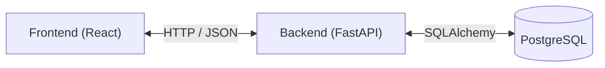

# Z Dech Pies

Wieloplatformowa aplikacja e-commerce umożliwiająca przeglądanie produktów, zarządzanie koszykiem, składanie zamówień oraz obsługę płatności internetowych.

System obejmuje aplikację webową PWA (React), backend oparty na FastAPI i PostgreSQL oraz panel administracyjny do zarządzania ofertą sklepu. W dalszych etapach planowany jest rozwój aplikacji mobilnej (React Native) i integracja z rzeczywistą bramką płatności.

## Funkcjonalności

**Dla klienta**
- przeglądanie katalogu produktów i kategorii
- zarządzanie koszykiem
- składanie zamówień
- rejestracja, logowanie i zarządzanie kontem użytkownika
- opcjonalna lokalna symulacja płatności

**Dla administratora**
- zarządzanie produktami i kategoriami (CRUD)
- zarządzanie cenami i stanami magazynowymi
- ukrywanie i ponowna aktywacja produktów
- podgląd i obsługa zamówień

## Technologie

| Obszar | Technologie |
| --- | --- |
| Frontend (web) | React, TypeScript, PWA |
| Frontend (mobile) | React Native (planowany) |
| Backend | Python, FastAPI |
| Baza danych | PostgreSQL |
| Chmura | AWS (docelowo) |

## Architektura

System oparty jest na architekturze trójwarstwowej. Obecnie aplikacja działa w środowisku lokalnym, natomiast docelowo planowane jest wdrożenie w chmurze AWS.

1. **Warstwa Web** – aplikacja PWA (React + TypeScript), obsługująca interfejs użytkownika, formularze i komunikację z REST API. Docelowo przewidziano hosting w Amazon S3 z dystrybucją przez CloudFront.
2. **Warstwa API** – backend w Pythonie (FastAPI), odpowiedzialny za logikę biznesową, walidację danych, uwierzytelnianie JWT oraz obsługę zapytań do bazy danych.
3. **Warstwa Database** – relacyjna baza PostgreSQL, przechowująca dane aplikacji. Migracje schematu realizowane są przez Alembic. Docelowo planowane jest wykorzystanie Amazon RDS w prywatnej podsieci VPC.

Komunikacja pomiędzy frontendem i backendem odbywa się przez REST API. Dostęp do PostgreSQL jest realizowany wyłącznie przez backend z wykorzystaniem SQLAlchemy.

### Schemat komunikacji



## Struktura repozytorium

```text
.
├── web/        # aplikacja PWA (React + TypeScript)
├── mobile/     # aplikacja mobilna (React Native)
├── backend/    # API (FastAPI)
├── db/         # migracje, skrypty i dane testowe bazy
├── infra/      # konfiguracja infrastruktury AWS
└── docs/       # dokumentacja projektu
```

## Uruchomienie lokalne

Do uruchomienia aplikacji wymagane są Python 3.12+, uv, Node.js, npm oraz PostgreSQL 16.

1. Przygotuj bazę PostgreSQL, role i migracje zgodnie z instrukcją [db/README.md](db/README.md).
2. W katalogu `backend/` zainstaluj zależności poleceniem `uv sync --locked`.
3. Przygotuj pliki `.env` oraz `.env.runtime` na podstawie dostępnych szablonów i ustaw `API_MODE=live`.
4. Uruchom backend:

   ```bash
   uv run uvicorn app.main:app --reload --host 127.0.0.1 --port 8000
   ```

5. W katalogu `web/` zainstaluj zależności za pomocą `npm ci`, przygotuj plik `.env` i ustaw `VITE_USE_MOCK_API=false` oraz `API_PROXY_TARGET=http://127.0.0.1:8000`.
6. Uruchom frontend:

   ```bash
   npm run dev
   ```

Frontend będzie dostępny pod adresem wskazanym przez Vite, a dokumentacja Swagger API pod `http://127.0.0.1:8000/docs`.

Szczegółowa instrukcja konfiguracji bazy, środowiska lokalnego i testów integracyjnych znajduje się w [docs/blok06-local.md](docs/blok06-local.md).

## API Endpoints

API udostępnia operacje CRUD dla produktów i kategorii oraz obsługę użytkowników, koszyka i zamówień.

Prefiks API: `/api/v1`.

| Metoda | Endpoint | Działanie |
| --- | --- | --- |
| GET | `/products` | Lista produktów |
| POST | `/products` | Dodanie produktu |
| PATCH | `/products/{id}` | Edycja produktu |
| DELETE | `/products/{id}` | Ukrycie lub usunięcie produktu |
| GET | `/categories` | Lista kategorii |
| POST | `/categories` | Dodanie kategorii |
| PATCH | `/categories/{id}` | Edycja kategorii |
| DELETE | `/categories/{id}` | Usunięcie pustej kategorii |
| POST | `/auth/login` | Logowanie użytkownika |
| GET | `/cart` | Odczyt koszyka |
| GET, POST | `/orders` | Pobieranie i tworzenie zamówień |

Przykładowe żądanie `POST /api/v1/products`:

```json
{
  "name": "Legowisko testowe",
  "slug": "legowisko-testowe",
  "price": "199.99",
  "stock_quantity": 3,
  "category_id": 1,
  "is_active": true
}
```

API zwraca odpowiednie kody HTTP, m.in. `200`, `201`, `204`, `400`, `401`, `403`, `404` i `409`.

Pełny opis endpointów, przykłady odpowiedzi JSON oraz kodów HTTP znajduje się w [docs/api-contract.md](docs/api-contract.md).

## Testowanie

Projekt wykorzystuje pytest do testowania backendu oraz Playwright do weryfikacji interfejsu użytkownika i integracji E2E.

Podstawowe polecenia:

```bash
# backend/
uv run pytest

# web/
npm run typecheck
npm run build
npm run test:e2e
```

Dodatkowo dostępne są testy pełnej integracji z rzeczywistą bazą PostgreSQL:

```bash
npm run test:e2e:live
```

Testy kontraktowe weryfikują interfejs i zgodność z API, natomiast testy live sprawdzają rzeczywisty przepływ danych pomiędzy React, FastAPI i PostgreSQL.

Szczegóły przygotowania środowiska testowego i scenariuszy znajdują się w [docs/blok06-local.md](docs/blok06-local.md).

## Zespół

| Rola | Osoba |
| --- | --- |
| DevOps / Project Manager | Paula Trzcińska |
| Frontend | Patryk Stulczewski |
| Backend | Dawid Makielak |
| Administrator bazy danych | Krzysztof Trzęsicki |

## Organizacja pracy

- zadania prowadzimy w GitHub Projects (tablica Kanban),
- każda zmiana trafia do gałęzi `main` przez Pull Request z przeglądem kodu.

## Architektura 3-tier

Poniższy diagram przedstawia docelową architekturę aplikacji w chmurze AWS.


