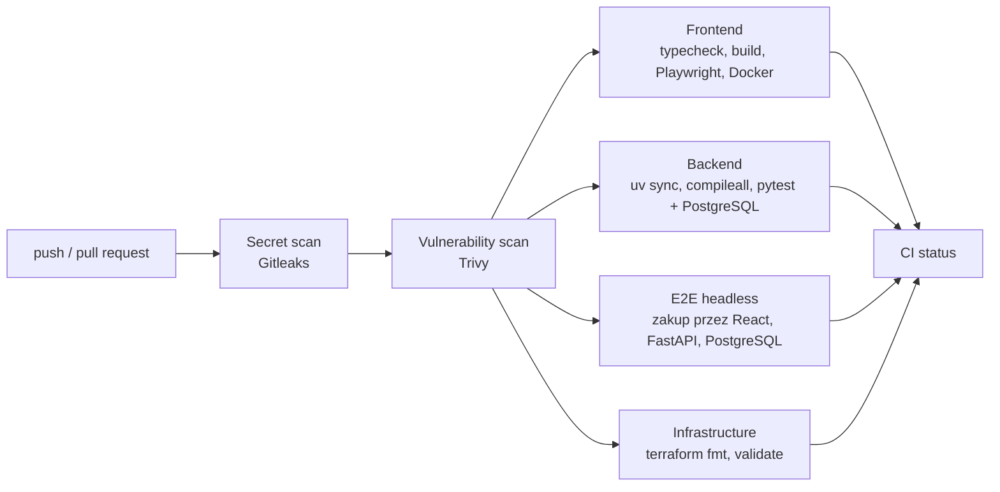

# Integracja ciągła i skanowanie bezpieczeństwa

Każdy push i każdy pull request do `main` uruchamia workflow
[`.github/workflows/ci.yml`](../.github/workflows/ci.yml). Zasada: błąd ma być
wykryty zanim kod trafi do `main` i do chmury, bez ręcznego sprawdzania.

## Przebieg



| Job | Co sprawdza | Kiedy kończy się błędem |
| --- | --- | --- |
| `Secret scan (Gitleaks)` | historia commitów pod kątem kluczy, haseł i tokenów | dowolny wykryty sekret |
| `Vulnerability scan (Trivy)` | `backend/uv.lock`, `web/package-lock.json`, sekrety w drzewie, konfiguracja Dockerfile i Terraform | podatność CRITICAL/HIGH z dostępną poprawką lub sekret; błędy konfiguracji są tylko raportowane |
| `Frontend build and tests (web)` | `npm ci`, `npm run typecheck`, `npm run build`, testy Playwright headless na kontraktowym API, budowa obrazu Nginx | błąd kompilacji TypeScript, budowania Vite, testu lub obrazu |
| `Backend build and tests (backend)` | `uv sync --locked`, kompilacja modułów, `pytest` na PostgreSQL 16 (kontener usługi, baza `shop_test`) | niezgodny lock, błąd składni, nieudany test |
| `Customer purchase E2E (headless, live API)` | Osobny PostgreSQL 16 (`shop_e2e_test`), migracje, seed, Playwright: rejestracja → produkt → koszyk → checkout → zapisane zamówienie i historia | błąd przygotowania środowiska albo ścieżki zakupu; bez ponawiania testu |
| `Infrastructure validation (terraform)` | `terraform fmt -check`, `init -backend=false`, `validate` | niesformatowany lub niepoprawny kod HCL |
| `CI status` | agreguje wyniki powyższych | którykolwiek job nie zakończył się sukcesem |

Kolejność jest celowa: `Vulnerability scan` zależy od `Secret scan`, a joby
budujące od obu skanerów (`needs`). Wyciek sekretu lub podatność CRITICAL/HIGH
zatrzymuje pipeline, zanim cokolwiek zostanie zbudowane. `CI status` jest jedynym wymaganym sprawdzeniem w ochronie gałęzi
`main`, dzięki czemu zmiana listy jobów nie wymaga zmiany ustawień repozytorium.

Osobny workflow [`codeql.yml`](../.github/workflows/codeql.yml) analizuje
statycznie kod TypeScript i Python (CodeQL, zestaw `security-and-quality`)
przy zmianach w `main` oraz co tydzień. Raporty Trivy i CodeQL trafiają do
zakładki **Security → Code scanning**.

## Raporty i artefakty testów

Po każdym uruchomieniu testów kroki `Upload …` z warunkiem `always()` zapisują
raporty także w razie błędu. Retencja wynosi 14 dni:

| Artefakt w Actions → CI → Artifacts | Zawartość |
| --- | --- |
| `pytest-results` | JUnit `pytest.xml` z testów API i PostgreSQL |
| `playwright-contract-results` | HTML, JUnit, a przy błędzie screenshot PNG, wideo WebM i trace ZIP |
| `playwright-live-results` | HTML, JUnit, a przy błędzie screenshot PNG i wideo WebM |

Jeżeli przygotowanie środowiska przerwie job przed uruchomieniem testów, raport
może nie powstać — przyczyna jest wtedy w logu nieudanego kroku. Zwykły sukces
nie zachowuje automatycznych screenshotów, wideo ani trace. Test katalogu zapisuje
też własny poglądowy screenshot. Przy ponowieniu nieudanego testu kontraktowego
materiały z pierwszej próby pozostają dostępne, a wynik jest oznaczony `flaky`.
Trace live jest wyłączony, ponieważ zawiera treść żądań logowania.

Po pobraniu i rozpakowaniu artefaktu otwórz katalog zawierający `index.html`
poleceniem `npx playwright show-report <katalog>` w środowisku z zależnościami
`web/`. Raport pokazuje nieudany krok, oczekiwanie, stack trace i załączniki.
XML JUnit pozwala przetwarzać wyniki maszynowo; log kroku podaje również liczbę
testów `passed`, `failed` i `skipped`. `CI status` wymaga sukcesu także nowego
jobu E2E; błąd testów blokuje automatyczne CD.

Komplet poleceń lokalnych (w tym tymczasowa baza Docker i odczyt raportów):
[README — Testowanie](../README.md#testowanie).

[`.github/dependabot.yml`](../.github/dependabot.yml) co tydzień proponuje
aktualizacje zależności npm (`web/`), uv (`backend/`), obrazów bazowych
Dockerfile, providerów Terraform i akcji GitHub. Alerty bezpieczeństwa
Dependabot działają niezależnie od harmonogramu.

## Ochrona gałęzi `main`

W ustawieniach repozytorium (**Settings → Branches** lub **Rules → Rulesets**)
dla `main` obowiązują:

- wymagany pull request przed scaleniem, co najmniej jedna akceptacja,
- wymagane sprawdzenie statusu `CI status` z aktualną gałęzią,
- zakaz wypychania bezpośrednio do `main` i wymuszonych pushy,
- brak możliwości obejścia reguł przez administratorów.

Dodatkowo w **Settings → Code security** włączone są Dependabot alerts,
Dependabot security updates, Secret scanning i Push protection, które blokują
push zawierający rozpoznany sekret jeszcze przed uruchomieniem workflow.

## Uruchomienie skanerów lokalnie

Te same narzędzia można uruchomić przed pushem (Docker):

```bash
docker run --rm -v "$PWD:/repo" ghcr.io/gitleaks/gitleaks:latest git /repo --redact -v
docker run --rm -v "$PWD:/repo:ro" aquasec/trivy:0.76.2 fs /repo --scanners vuln,secret --severity CRITICAL,HIGH --ignore-unfixed
docker run --rm -v "$PWD:/repo:ro" aquasec/trivy:0.76.2 fs /repo --scanners misconfig --severity CRITICAL,HIGH
```

W PowerShell zamiast `$PWD` użyj `${PWD}`; przy błędzie `dubious ownership`
dodaj `-e GIT_CONFIG_COUNT=1 -e GIT_CONFIG_KEY_0=safe.directory -e GIT_CONFIG_VALUE_0='*'`.

Gitleaks dopasowuje wzorce (np. `AKIA…`, `ghp_…`), więc wykrywa także fikcyjne
klucze testowe. Trivy weryfikuje sumy kontrolne tokenów i zgłasza wyłącznie
wartości o poprawnej strukturze. Podatności w zależnościach usuwa się
aktualizacją locka, np. `uv lock --upgrade-package <pakiet>` w `backend/`
albo `npm update <pakiet>` w `web/`, a nie wyłączaniem skanera.

## Znane ostrzeżenia konfiguracji

Trivy zgłasza (bez blokowania) m.in. nieograniczony ruch wychodzący grup
bezpieczeństwa (AWS-0104), publiczne IP w podsieci `public-web` (AWS-0164),
retencję kopii RDS 1 dzień (AWS-0077) oraz brak `USER` w obrazie Nginx
(DS-0002). Pierwsze trzy wynikają z założeń architektury i limitów konta AWS
opisanych w [`infra/README.md`](../infra/README.md); ich ewentualne zaostrzenie
to decyzja zespołu, nie wymóg pipeline'u.
