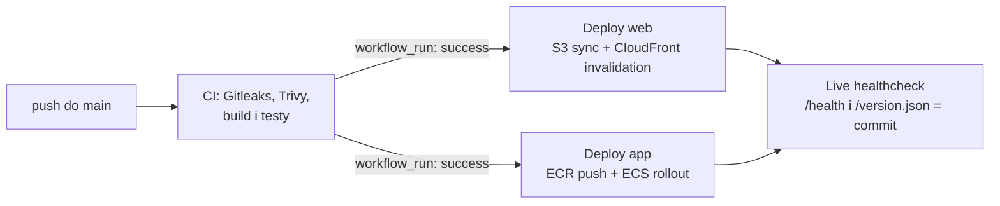
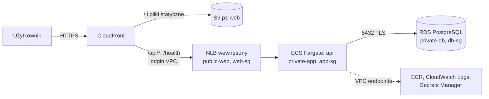

# Wdrożenie do AWS (Continuous Deployment)

Każdy commit, który trafi do `main` i przejdzie workflow **CI**
([`ci.yml`](../.github/workflows/ci.yml)), jest automatycznie wdrażany do AWS przez
workflow **Deploy** ([`.github/workflows/deploy.yml`](../.github/workflows/deploy.yml)).
Automatyczne wdrożenie po pushu czeka na zielone testy i skany.
Dostępne jest również ręczne uruchomienie `workflow_dispatch`, opisane poniżej.

## Publiczny adres

Live URL: [https://d295uboxigcnkp.cloudfront.net](https://d295uboxigcnkp.cloudfront.net).
Frontend i API korzystają z tej samej domeny. Dostępne są również
[Swagger UI](https://d295uboxigcnkp.cloudfront.net/docs),
[OpenAPI](https://d295uboxigcnkp.cloudfront.net/openapi.json),
[healthcheck](https://d295uboxigcnkp.cloudfront.net/health) i
[wersja frontendu](https://d295uboxigcnkp.cloudfront.net/version.json).
Adres jest wartością `PUBLIC_URL` i outputu Terraform `public_url`.

## Przebieg



| Job | Co robi | Kiedy kończy się błędem |
| --- | --- | --- |
| `Deploy web (S3 + CloudFront)` | `npm run build` z `VITE_APP_VERSION=<commit>`, `aws s3 sync` (pliki `assets/*` z cache na rok, reszta `no-cache`, `--delete`), unieważnienie cache CloudFront | błąd buildu, brak uprawnień, nieudana inwalidacja |
| `Deploy app (ECS Fargate)` | `docker build` z `backend/Dockerfile`, push do ECR z tagiem = hash commita (tagi niemutowalne; ponowny run dla tego samego commita używa istniejącego obrazu), nowa rewizja task definition (obraz + `APP_VERSION`), `update-service` i oczekiwanie na stabilność; kontener przy starcie wykonuje `alembic upgrade head` | nieudany build, błąd migracji lub health checku (ECS cofa wdrożenie, usługa nie osiąga stabilności) |
| `Live healthcheck` | `GET /health` (API) i `GET /version.json` (web) pod publicznym adresem muszą zwrócić `version` równy wdrożonemu commitowi; strona główna musi się ładować | po 30 próbach (5 min) wersja nadal nie odpowiada commitowi |

Oba joby wdrożeniowe mają warunek `conclusion == success` i `event == push`, więc
pull requesty i nieudane CI nie wdrażają niczego. Wdrożenia są serializowane
(`concurrency: deploy-production`). Ręczne uruchomienie (`workflow_dispatch`)
wdraża aktualny `main`.

## Uwierzytelnienie GitHub → AWS

Docelową metodą było OIDC (krótkotrwałe tokeny bez stałych kluczy), ale na tym
koncie jest ono niedostępne: konto działa w planie Free i polityka SCP narzucona
przez AWS jawnie blokuje `iam:CreateOpenIDConnectProvider` (sprawdzone
14.11.2026). Dlatego workflow loguje się kluczem dostępowym technicznego
użytkownika IAM `pz-github-deploy` ([`infra/terraform/deploy.tf`](../infra/terraform/deploy.tf)).

Zabezpieczenia tego wariantu:

- **Klucz tylko w sekretach środowiska `production`** (Settings → Environments →
  production → Environment secrets: `AWS_ACCESS_KEY_ID`, `AWS_SECRET_ACCESS_KEY`),
  nigdy w kodzie ani w pliku `.yml`. Sekrety środowiska może ustawić tylko
  właściciel repozytorium.
- **Środowisko `production` przyjmuje wdrożenia wyłącznie z gałęzi `main`**
  (Deployment branches and tags → Selected: `main`). Workflow uruchomiony z innej
  gałęzi nie dostanie klucza, a do `main` kod trafia tylko przez PR z akceptacją
  i zielonym `CI status`.
- **Minimalne uprawnienia użytkownika**: zapis do bucketu web, inwalidacja jednej
  dystrybucji, push do jednego repozytorium ECR, rejestracja task definition
  i aktualizacja jednej usługi ECS. Użytkownik nie ma dostępu do konsoli.
- **Klucza nie tworzy Terraform**, bo trafiłby jawnie do pliku stanu. Generuje się
  go ręcznie (`aws iam create-access-key --user-name pz-github-deploy`) i od razu
  wpisuje do sekretów. Rotacja: utworzyć nowy klucz, podmienić sekrety, usunąć
  stary (`aws iam delete-access-key`).

Identyfikatory zasobów workflow czyta z **Variables** repozytorium
(Settings → Secrets and variables → Actions → Variables); wartości daje `terraform output`.
To nie są sekrety, więc mogą być zmiennymi repozytorium (widzi je też job
healthcheck, który nie używa środowiska `production`):

| Variable | Output Terraform |
| --- | --- |
| `AWS_REGION` | `eu-north-1` |
| `WEB_BUCKET` | `web_bucket` |
| `CLOUDFRONT_DISTRIBUTION_ID` | `cloudfront_distribution_id` |
| `ECR_REPOSITORY` | `ecr_repository` |
| `ECS_CLUSTER` | `ecs_cluster` |
| `ECS_SERVICE` | `ecs_service` |
| `PUBLIC_URL` | `public_url` |

## Architektura wdrożenia



- **Warstwa web** - build React w prywatnym buckecie S3 (brak dostępu publicznego,
  szyfrowanie, wersjonowanie), czytanym przez CloudFront przez Origin Access Control. Funkcja
  CloudFront `spa-rewrite` kieruje trasy aplikacji (np. `/products/3`) na
  `index.html`. Pliki `assets/*` mają hash w nazwie i cache na rok; `index.html`,
  `sw.js`, `manifest.json` i `version.json` są zawsze rewalidowane.
- **Warstwa app** - backend jako kontener ECS Fargate (0,25 vCPU, 512 MiB) w podsieci
  `private-app` bez publicznego IP. Wejście tylko przez wewnętrzny Network Load
  Balancer w podsieci `public-web` z grupą `web-sg`, do którego CloudFront łączy się
  jako *origin VPC*. Kaskada grup bezpieczeństwa z `main.tf` zostaje bez zmian:
  NLB (`web-sg`) → kontener (`app-sg`, port 8000 tylko z `web-sg`) → RDS (`db-sg`).
  Obraz, logi i sekrety przechodzą przez prywatne punkty końcowe VPC
  ([`endpoints.tf`](../infra/terraform/endpoints.tf)), bo podsieć nie ma trasy do Internetu.
- **Jeden publiczny adres** - frontend i API są pod tą samą domeną CloudFront
  (`/api/*`, `/health`, `/docs`, `/openapi.json` idą do backendu), więc frontend
  używa względnych ścieżek i nie ma CORS.
- **Konfiguracja i sekrety** - zmienne nietajne są w task definition;
  `DB_PASSWORD`, `MIGRATION_DB_PASSWORD` i `JWT_SECRET` ECS wstrzykuje przy starcie
  z sekretu Secrets Manager `pz/api`. Połączenie z RDS jest szyfrowane i
  weryfikowane (`DATABASE_SSL_CA` wskazuje pakiet CA Amazon RDS wbudowany w obraz).
- **Wersja wdrożenia** - `APP_VERSION` (backend) i `VITE_APP_VERSION` (frontend) to
  hash commita: `GET /health` w trybie live zwraca `{"status":"UP","database":"UP","version":"<sha>"}` po udanym `SELECT 1` (błąd DB: HTTP 500), frontend
  publikuje `/version.json` i pokazuje skróconą wersję w stopce.

## Obraz backendu

[`backend/Dockerfile`](../backend/Dockerfile) buduje się z katalogu głównego repo
(migracje są w `db/`): zależności z `uv.lock`, obraz `python:3.12-slim`, użytkownik
`app`, `HEALTHCHECK` na `/health`. Z `RUN_MIGRATIONS=true` (ustawione w task
definition) kontener najpierw wykonuje `alembic upgrade head` kontem migracyjnym,
a dopiero potem startuje API. Lokalnie:

```bash
docker build -f backend/Dockerfile -t zdechpies-api .
docker run --rm -p 8000:8000 --env-file backend/.env --env-file backend/.env.runtime \
  -e DB_HOST=host.docker.internal -e DATABASE_SSL_CA= -e RUN_MIGRATIONS=true zdechpies-api
```

Puste `DATABASE_SSL_CA` wyłącza TLS do bazy (lokalny PostgreSQL bez certyfikatu).

## Pierwsze uruchomienie (jednorazowo, ręcznie)

1. `terraform apply` w `infra/terraform` kontem z uprawnieniami do IAM, S3,
   CloudFront, ECR, ECS, ELB, Logs, Secrets Manager i VPC (np. AWS CloudShell).
   Sieć i RDS utworzono ręcznie, więc najpierw import - patrz
   [infra/README.md](../infra/README.md#terraform).
2. Uzupełnij sekret `pz/api` (ARN w outputach) wartościami JSON
   `{"DB_PASSWORD": "...", "MIGRATION_DB_PASSWORD": "...", "JWT_SECRET": "..."}`
   i nadaj te same hasła rolom `shop_app` i `shop_migrator` w RDS
   ([`db/init/00-roles.sh`](../db/init/00-roles.sh)). Po pierwszym wdrożeniu wykonaj
   jako `shop_migrator` [`db/scripts/grant-app-permissions.sql`](../db/scripts/grant-app-permissions.sql).
3. Wpisz outputy Terraform do Variables repozytorium. W środowisku GitHub
   `production` ogranicz wdrożenia do gałęzi `main` i dodaj sekrety
   `AWS_ACCESS_KEY_ID` / `AWS_SECRET_ACCESS_KEY` z wyniku
   `aws iam create-access-key --user-name pz-github-deploy` (wymaga właściciela repozytorium).
4. Pierwszy deploy: push do `main` (po zielonym CI) albo Actions → Deploy → *Run workflow*.

Logi backendu: `aws logs tail /ecs/pz-api --follow`. Powrót do poprzedniej wersji:
*Re-run* wcześniejszego zielonego runa **Deploy**.

## Znane ostrzeżenia skanera konfiguracji

Trivy (job `Vulnerability scan` w CI, tryb raportowania) zgłasza dla `web.tf` brak
WAF (AWS-0011), brak logów dostępu CloudFront (AWS-0010) i szyfrowanie S3 kluczem
AWS zamiast klucza KMS klienta (AWS-0132). To płatne rozszerzenia bez wpływu na
poprawność wdrożenia; bucket jest prywatny i szyfrowany.

## Koszt (szacunek, eu-north-1)

Fargate ok. 9 USD/mies., NLB ok. 17 USD, punkty końcowe VPC ok. 30 USD, CloudFront,
S3, ECR i logi w granicach darmowego poziomu; łącznie ok. 55 USD/mies. plus RDS.
Między zajęciami usługę można wyłączyć (`app_desired_count = 0`).
