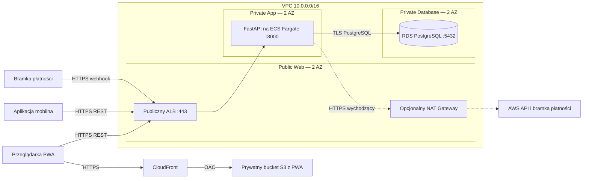

# Propozycja architektury AWS

Status: projekt do akceptacji. Zasoby aplikacyjne na diagramie opisują wariant
docelowy; obecny Terraform tworzy wyłącznie fundament sieciowy i Security Groups.

## Warstwy i przepływ

S3 i CloudFront są usługami zarządzanymi poza podsieciami VPC. **Public Web**
w VPC oznacza warstwę wejściową ALB, a nie serwer statycznej PWA. To zachowuje
podział 3-tier bez stawiania zbędnego serwera WWW. Bucket PWA ma Block Public
Access i politykę dopuszczającą wyłącznie konkretną dystrybucję CloudFront przez
Origin Access Control (OAC). Zdjęcia produktów docelowo mają osobny bucket.

Publiczny jest punkt wejścia HTTPS w ALB. Kontenery FastAPI nie mają publicznych
IP, przyjmują ruch tylko z SG load balancera i nie są dostępne bezpośrednio
z internetu. RDS ma `publicly_accessible = false`; jego SG przyjmuje port 5432
wyłącznie z SG aplikacji. CORS ogranicza originy przeglądarki, a kontrolę
użytkownika i administratora realizuje API.

## Plan adresacji

Domyślny region to `eu-central-1`; można go zmienić na region dozwolony w koncie
edukacyjnym, np. `us-east-1`. Terraform wybiera dwie dostępne standardowe AZ.

| Warstwa | AZ a | AZ b | Routing |
| --- | --- | --- | --- |
| Public Web | `10.0.0.0/24` | `10.0.1.0/24` | `0.0.0.0/0 → Internet Gateway` |
| Private App | `10.0.10.0/24` | `10.0.11.0/24` | lokalny VPC + Gateway do S3; opcjonalnie NAT |
| Private Database | `10.0.20.0/24` | `10.0.21.0/24` | wyłącznie lokalny VPC |

Każda warstwa ma osobne tablice tras lub osobne powiązania do swojej tablicy.
Podsieci nie przypisują publicznych IP automatycznie. Domyślna SG VPC jest pusta;
aplikacja używa dedykowanych grup.

## Reguły Security Groups

| Grupa docelowa | Źródło | Port | Przeznaczenie |
| --- | --- | --- | --- |
| Web / ALB | Internet | TCP 443 | Jedyny publiczny punkt wejścia |
| App / FastAPI | SG Web | TCP 8000 | Żądania i health check `/health` |
| Database / PostgreSQL | SG App | TCP 5432 | Połączenia API z bazą |

Wyjście Web ograniczono do App:8000; wyjście App do Database:5432 i HTTPS:443.
Database nie ma reguł wyjściowych. Security Groups są stanowe, więc odpowiedzi na
zaakceptowane połączenia nie wymagają osobnych reguł. Brak publicznego SSH.
Administracja i migracje powinny korzystać z osobnej, kontrolowanej ścieżki
w VPC, np. zadania ECS; dostępu administracyjnego nie otwieramy z internetu.

## Kolejny etap: uruchomienie usług

Po akceptacji fundamentu i wyborze konta DEVOPS-4 powinien dodać:

1. ECR z wersjonowanym obrazem backendu, task definition i usługę ECS Fargate
   w `app_subnet_ids`, `assign_public_ip = false`, z SG App.
2. Internet-facing ALB w `public_subnet_ids`, z SG Web, target group typu `ip`
   i health check `/health`. Listener 443 potrzebuje certyfikatu ACM oraz domeny;
   port 8000 nie jest publikowany. Wewnętrzny odcinek ALB → FastAPI pozostaje
   w VPC; jeśli wymagany jest również TLS na tym odcinku, wymaga osobnej konfiguracji.
3. RDS PostgreSQL z DB subnet group obejmującą obie podsieci Database, prywatnym
   adresem, szyfrowaniem, backup retention 7 dni i połączeniami TLS. Dwie podsieci
   nie oznaczają dwóch płatnych instancji: wariant demonstracyjny może być Single-AZ.
4. Oddzielne konto aplikacyjne PostgreSQL z minimalnymi uprawnieniami oraz konto
   do migracji. Task aplikacji nie otrzymuje hasła administratora RDS.
5. Prywatny S3 + CloudFront OAC dla PWA, osobny bucket zdjęć, domenę API w CORS.
6. CloudWatch dla logów, Secrets Manager lub Parameter Store dla sekretów;
   osobne role task execution oraz task role z dostępem do konkretnych zasobów.

Model danych, migracje Alembic i logika API należą do zadań Backend/Database.
Ta konfiguracja sieci ich nie zastępuje.

## Dostęp wychodzący i budżet

Fundament ma domyślnie wyłączony NAT i nie tworzy ALB, Fargate ani RDS.
S3 Gateway endpoint umożliwia regionalny dostęp do S3 bez opłaty za endpoint.
Sam endpoint S3 nie wystarcza do startu prywatnego Fargate: pobieranie obrazów,
logi i sekrety wymagają odpowiednich endpointów lub NAT.

Wariant prosty to `enable_nat_gateway = true`: jedna brama w AZ a, używana przez
obie podsieci App. Ogranicza liczbę bram, lecz jest pojedynczym punktem awarii
i może generować ruch między AZ. Wariant HA wymaga osobnych bram na AZ.
Zestaw endpointów ECR API/DKR, CloudWatch i Secrets Manager też ma koszty;
ponadto nie zastępuje wyjścia do zewnętrznej bramki płatności.

Nie zakładamy darmowego działania całości. NAT ma opłatę za czas i przetwarzane
dane, ALB za czas i obciążenie, Fargate za przydzielone zasoby, a RDS za instancję,
storage i ewentualne dodatkowe backupy. Zatrzymanie kontenera nie usuwa opłat za
pozostałe zasoby. DevOps przygotowuje kalkulację dla wybranego regionu i planu
konta, ustawia AWS Budgets i uzgadnia harmonogram działania na prezentacje.
Alert budżetowy jest powiadomieniem, a nie automatycznym limitem wydatków.

## Źródła

- [Prywatne zadania ECS i dostęp wychodzący](https://docs.aws.amazon.com/AmazonECS/latest/developerguide/networking-outbound.html)
- [RDS w VPC i wymagania DB subnet group](https://docs.aws.amazon.com/AmazonRDS/latest/UserGuide/USER_VPC.WorkingWithRDSInstanceinaVPC.html)
- [CloudFront OAC i prywatny origin S3](https://docs.aws.amazon.com/AmazonCloudFront/latest/DeveloperGuide/private-content-restricting-access-to-s3.html)
- [S3 Gateway endpoint — routing i rozliczenia](https://docs.aws.amazon.com/vpc/latest/privatelink/vpc-endpoints-s3.html)
- [Rozliczanie NAT Gateway](https://docs.aws.amazon.com/vpc/latest/userguide/nat-gateway-pricing.html)
- [Cennik Elastic Load Balancing](https://aws.amazon.com/elasticloadbalancing/pricing/)
